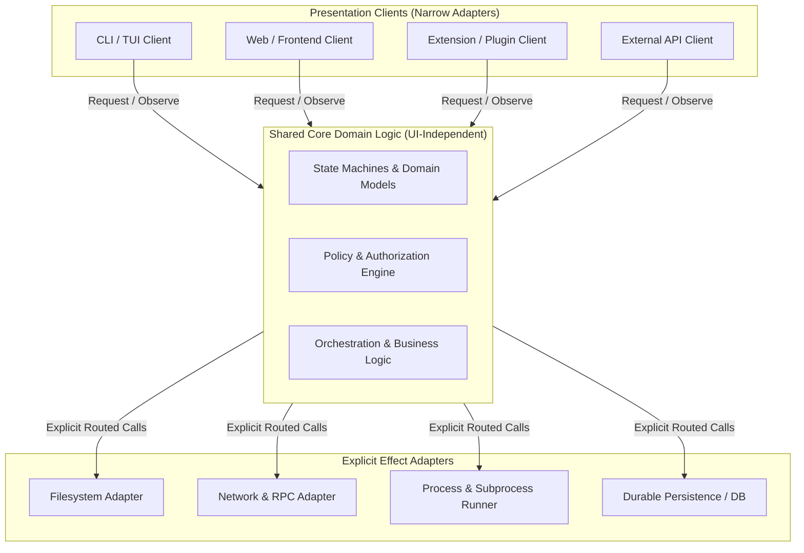

# Core engineering principles and architecture patterns

Design changes for the entire system and the people who will operate, maintain, and interact with it. Do not take
shortcuts that bypass existing boundaries, leave contracts incomplete, or mask underlying design flaws.

---

## 1. The eight core engineering principles

### Principle 1: Understand before editing
Read the implementation, its actual callers, existing regression suites, and relevant architecture notes before writing
code. Trace the flow from user input through client parsers, protocols, services, and persistence layers.
- Verify what actually exists in runtime code; a proposed design or familiar-looking API name is not implementation evidence.
- Identify existing invariants, assumptions, and constraints.
- Avoid premature refactoring or speculative restructuring while researching a specific behavior.

### Principle 2: Define the contract
Establish observable success criteria, critical failure cases, and system constraints before writing code.
- For cross-component features, write down the interface definitions, state transitions, authority models, and verification
  strategy.
- Compare architectural alternatives when choices have lasting downstream consequences; document the rationale and
  tradeoffs.
- Keep routine fixes lightweight, but ensure the contract being fixed is clearly stated.

### Principle 3: Fix the cause at the responsible component
Reproduce the bug at the boundary where it occurs, identify the broken invariant, and fix it directly where that invariant
belongs.
- **Never substitute a hack for a fix**: Do not use input-specific special cases, arbitrary sleeps, swallowed errors,
  silent fallbacks, or destructive user data resets to bypass an error.
- If a temporary compatibility adapter is strictly necessary, give it an explicit typed contract, thorough validation, a
  documented rationale, and a concrete removal condition.

### Principle 4: Keep one authority for each rule and state
Maintain single sources of truth. Avoid parallel implementations or fragmented decision logic that can fall out of sync.
- Keep permission decisions, authorization logic, and durable execution in designated authoritative services or daemon
  components; client interfaces present options and request execution.
- Update central schemas or protocol definitions at the source, and regenerate downstream clients and models.
- Never maintain duplicate parsers or shadow state stores that can disagree on ground truth.

### Principle 5: Make boundaries explicit
Use cohesive components, narrow interfaces, and strongly typed inputs, outputs, and errors.
- Separate domain business rules from network transport, persistence mechanisms, and user presentation.
- Introduce abstractions only for present, concrete needs; resist speculative frameworks, premature generalizations, and
  hidden coupling via global mutable state.

### Principle 6: Design the failure path
Robustness is determined by how systems handle failure, cancellation, and partial execution.
- For all asynchronous, network, or durable workflows, define explicit cancellation, resource cleanup, timeouts, retry
  semantics, and partial-completion behavior.
- Retry side-effecting operations only when they are proven idempotent; preserve uncertainty when completion cannot be
  definitively confirmed.
- Account for service restarts, process crashes, and pre-existing legacy data when altering storage schemas or lifecycles.
- Surface clear, actionable error messages to users without exposing sensitive credentials, tokens, or internal tracebacks.

### Principle 7: Make changes coherent and reviewable
Deliver one understandable, bounded behavior at a time, accompanied by its actual callers, documentation, and validation.
- "Small" means a complete, self-contained change—not merely the fewest lines of code modified.
- Clean up superseded code paths within your scope, and leave unrelated code completely undisturbed.
- Maintain documentation integrity: preserve unrelated comments and docstrings.

### Principle 8: Review system fit as well as correctness
Before finishing, inspect the complete change for misplaced policy, duplicated state, concurrency races, compatibility
breaks, and missing user interactions.
- Ask: *Can a future developer use this interface correctly without knowing its internal implementation details?*
- Green tests do not resolve architectural flaws, leaky abstractions, or poor ergonomics.

---

## 2. Architecture patterns: shared core and explicit integration

Modern resilient applications decouple reusable domain logic from presentation layers and platform lifecycles.

### 1. UI-independent shared core
Keep reusable domain logic completely independent of UI frameworks, event loops, and client process lifetimes. Place
platform-specific integrations behind narrow adapters while preserving native platform behavior. Share the core without
forcing every client into an identical user experience.

### 2. Design APIs around real callers
Introduce shared APIs and interfaces only when backed by an actual production usage. Restrict dependencies strictly to
what the component requires, and document compatibility, resource cleanup, and lifecycle obligations before exposing an
API to extensions or external clients.

### 3. Separate state transitions from external effects
Route all external side effects (filesystem writes, process execution, network requests) through explicit interfaces.
This ensures that permissions, ordering, cancellation, rate limiting, and recovery remain centrally enforceable. A
domain component must never secretly acquire process authority, access ambient filesystem paths, or initiate background
tasks that its caller cannot manage.

### 4. Explicit mutation and observation authority
Specify which component, actor, or thread is permitted to mutate state, how other components observe state changes,
and who is responsible for releasing resources. Document callback execution contexts, reentrancy rules, and threading
models at the interface boundary.

### 5. Responsiveness as a design constraint
Treat interactive responsiveness as a core architectural constraint:
- Never perform blocking I/O, heavy parsing, or disk operations on UI or interactive event threads.
- Bound in-memory queues and retained buffers to prevent memory leaks and out-of-memory crashes.
- Define explicit backpressure handling, shedding, or throttling for slow consumers.
