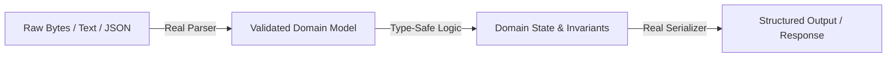

# Structure over string matching: type-driven design

Code must operate on structure and well-defined types, never on patterns in text. This principle applies across all
languages and frameworks.

When software manipulates unstructured strings or uses string matching to extract information, it invites injection
vulnerabilities, subtle parsing bugs, drift across components, and runtime crashes that static analyzers cannot detect.

---

## 1. Parse at the boundary, serialize on exit

Raw text, serialized bytes, and protocol payloads must become strongly typed domain models immediately upon entering the
system. They remain typed throughout all domain logic and are serialized back to raw formats only when crossing an
external boundary.



### 1. Always use real grammar-aware parsers
Never parse structured text with hand-written splitters, string slicing, or regular expressions.
- **JSON**: Use `JSONDecoder` into `Codable` structs in Swift; `pydantic` or `json.loads` with typed validation in
  Python; Zod or TypeScript schema parsers in TypeScript.
- **URLs and Query Strings**: Use `URLComponents` in Swift; `urllib.parse` in Python; `URL` / `URLSearchParams` in
  TypeScript.
- **Config Formats (TOML/YAML/XML)**: Use standard library `tomllib`, real XML parsers (`XMLParser`), or dedicated
  validated serializers.
- **Command Syntax & Grammars**: Use dedicated tokenizers or CLI parsers (e.g. `ArgumentParser`, `click`).

### 2. Always emit through serializers
Never generate structured output by interpolating or concatenating strings:
```swift
// WRONG: Fragile string interpolation
let payload = "{\"user\": \"\(username)\", \"role\": \"\(role)\"}"

// RIGHT: Structured serialization
let payload = try JSONEncoder().encode(UserPayload(user: username, role: role))
```

---

## 2. Eliminate string patterns and regex for structured data

### The anti-patterns
- **No regular expressions for structured formats**: Do not use regex to parse HTML, JSON, URLs, headers, or file paths.
- **No substring matching for decisions**: Do not use `contains()`, `hasPrefix()`, `hasSuffix()`, or `range(of:)` to
  determine what kind of entity an object is or what state it is in.
- **No split-and-index**: Do not use `string.split("/")[1]` or `parts[2]` to extract fields from structured paths or
  identifiers. Use dedicated path-handling APIs or typed parsers.

### Match types and enum cases, never error messages
When handling errors, never match against error message strings:
```swift
// WRONG: Matching error message strings
catch {
    if error.localizedDescription.contains("not found") { ... }
}

// RIGHT: Matching typed error hierarchies
catch StorageError.itemNotFound(let id) {
    ...
}
```

```python
# WRONG: String pattern matching on errors
except Exception as e:
    if "Connection refused" in str(e):
        ...

# RIGHT: Matching typed exception classes
except ConnectionRefusedError:
    ...
```

---

## 3. Strong types over loose strings and dictionaries

### 1. States and kinds are closed types
Discrete states, roles, modes, event kinds, and categories must be represented as explicit enums or algebraic data
types—never as unconstrained strings. Follow the language guide: Swift and Python use enums; TypeScript uses
string-literal or discriminated unions.
- **Forbidden**: Passing `status = "pending"` or `mode = "bypass"` as raw strings with valid options noted in comments.
- **Required**: `enum TaskState { case pending, inProgress, completed }` or `class PermissionMode(StrEnum)`.

### 2. No bare dictionaries for structured data
Avoid untyped dictionaries such as `[String: Any]` in Swift, `dict[str, Any]` in Python, or `Record<string, any>` in
TypeScript. Define explicit data models with typed attributes for any data structure that has a defined schema.

### 3. Strongly typed identifiers
Identifiers that carry a kind or namespace must be represented as structured types, not strings with delimiters:
```swift
// WRONG: Untyped string with prefix
let entityId = "user_98471"

// RIGHT: Strongly typed identifier
enum EntityID: Hashable, Codable {
    case user(Int)
    case session(UUID)
    case organization(String)
}
```

---

## 4. When text matching is acceptable

Text matching is legitimate in exactly two scenarios:
1. **Unstructured human search**: When a human user inputs arbitrary search terms into a search bar, filter box, or
   fuzzy matcher.
2. **Third-party tooling limitations**: When an external CLI or unmodifiable legacy tool outputs only plain text and
   provides no structured JSON/RPC interface.

Whenever text matching is used for an external tool, isolate it behind a narrow adapter and document the reason in a
comment:
```swift
// Text matching used here because git CLI does not offer structured JSON output for cherry-pick conflicts.
```
