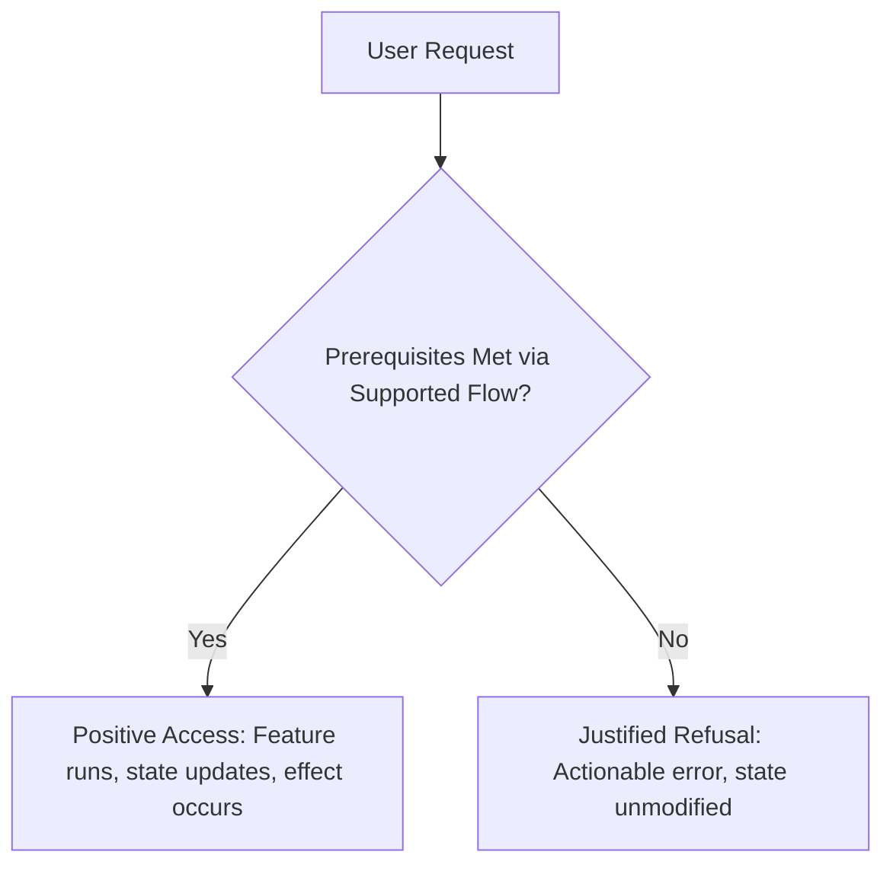
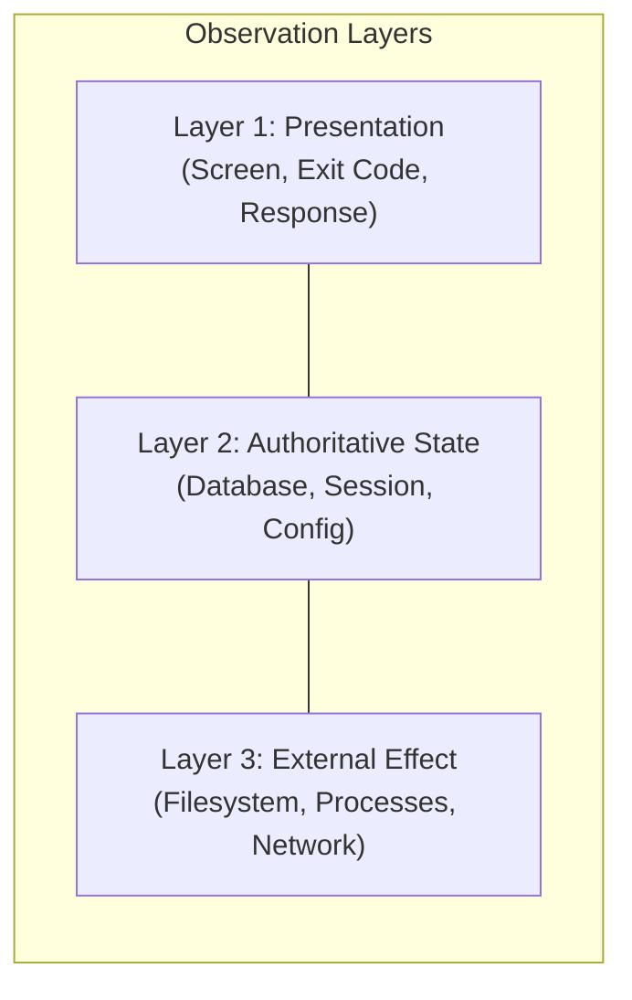

# User flow audit

Find promised behavior that is missing, unreachable, incorrectly gated, or supported by narrower evidence than its
qualification claims. Run concrete checks at the real user boundary and retain their outcomes. A source-code review,
unit test suite, or proposed plan alone is not a substitute for an interactive user-flow audit.

This guide provides a systematic methodology for verifying that features promised by documentation, specifications,
or architecture are genuinely reachable and functional for real human users and external clients. It is grounded in
empirical testing and agent evaluation research from Anthropic, OpenAI, Google, Microsoft, and NIST (see the
[research foundations and empirical evidence](user-flows/research.md) for full citations and theoretical background).

## The problem: why unreachable features occur

A common failure mode in software engineering is the mismatch between implementation artifacts and observable user
reality:

- **Component vs. Entry-Point Split**: A feature may have complete domain models, comprehensive policy logic, robust
  database tables, and green unit tests, while the user-facing entry point (CLI argument parser, interactive menu,
  web UI form, keyboard shortcut, or config schema) never exposes the option, drops the parameter, or wires it to the
  wrong handler.
- **Two-Sided Obligation**: Any capability has two distinct obligations:
  1. The client/interface must provide a reachable, discoverable path for the user to request the feature and satisfy
     its prerequisites.
  2. The underlying engine/backend must accept an authorized request while strictly enforcing rules and restrictions.
  Testing only the engine's refusal leaves the client's reachability unproven.
- **Shared-Omission Fallacy**: When tests derive expected options or test inputs from the same internal enum, parser,
  or schema that omitted the feature, tests and production code will happily agree that everything is complete.
- **Mocked Boundaries**: Mocking OS permissions, file systems, daemon lifecycles, or network gateways can hide broken
  interactive handling, premature acknowledgments, or dropped state across process boundaries.

## Establish scope and observable contracts

Start with the requested feature or release scope. If auditing an unfamiliar or broad system, survey the documented
capabilities, pick a bounded batch prioritized by user impact and missing evidence, and explicitly mark unsampled
features as unqualified.

Compare promises with implementation in **both directions**:
1. **Promise to Code**: Every documented command, flag, UI element, or API method must have a reachable implementation
   or an explicit, documented exclusion.
2. **Code to Promise**: Every public capability or privileged mode in the codebase must have an intended caller, clear
   preconditions, and a qualified outcome.

Before executing checks, formulate a scenario matrix independently of the production option list:

| Field | Required content |
| --- | --- |
| **Promise and entry path** | User goal and exact command, UI action, shortcut, or interaction. |
| **Initial state** | Fresh vs. existing data, default vs. custom configuration, clean vs. migrated state. |
| **Preconditions** | How a real user satisfies each prerequisite (auth, config, grants) using standard user flows. |
| **Expected result** | User presentation (screen/exit code), authoritative state (DB/config), and real external effects. |
| **Lifecycle and recovery** | Behavior across cancellation, interruption, disconnect, resume, restart, or revocation. |
| **Verification and evidence** | Test identity, execution receipts, recorded logs/artifacts, and explicit untested boundaries. |

> [!IMPORTANT]
> Derive expected choices and arguments from user requirements and documentation, never from the internal parser or
> production code under test.

---

## The five core audit steps

### 1. Prove successful access and justified refusal (symmetric verification)

Every gated or privileged capability requires paired verification:

- **Positive Access**: Run a request with all prerequisites satisfied through normal user mechanisms. Confirm the
  user successfully reaches and executes the feature.
- **Justified Refusal**: Remove or invalidate **one prerequisite at a time**. Confirm the system refuses access with an
  actionable, descriptive message, leaving state unmodified.

**Rules for symmetric verification:**
- A check that only tests refusal will pass even if the feature is completely broken or permanently disabled for all
  users.
- A check that only tests positive access will pass even if security controls, authorization checks, or configuration
  gates are completely bypassed.
- Satisfy prerequisites using the **standard user flow** (e.g. running an auth command, answering a prompt, or setting
  a documented config option). Do not cheat by manually injecting database rows, pre-seeding private tokens, or calling
  internal debug hooks unless testing that exact lower-level component in isolation.

### 2. Vary initial conditions and action sequences

Bugs frequently hide in untested state combinations and non-trivial action orders rather than isolated operations.

#### Initial condition factors
Identify factors relevant to the system and test representative combinations:
- **Data baseline**: Fresh start (first run, empty directory) vs. existing data (upgraded database, legacy schema).
- **Configuration**: Default settings vs. explicit flags vs. environment variable overrides.
- **Authority and Trust**: Authenticated vs. anonymous, trusted workspace vs. untrusted directory, elevated vs. standard
  privileges.
- **Execution mode**: Interactive terminal (PTY) vs. piped/headless execution (CI/script), attached client vs. detached
  background worker.

Use combinatorial thinking: apply pairwise sampling across general configuration factors, but mandate explicit
coverage for high-risk combinations (such as privileged flags executed against an untrusted workspace or legacy data).

#### Action ordering and stateful transitions
Do not limit testing to happy-path one-shot operations. Exercise realistic user sequences:
- `Action → Cancel → Re-execute`: Does cancelling an operation leave the system in a clean, re-enterable state?
- `Configure → Restart → Resume`: Does persistent state survive an application crash or service restart?
- `Grant → Revoke → Attempt Access`: Does permission revocation take effect immediately, or does stale in-memory authority
  persist?
- `Partial Failure → Retry`: Does an interrupted network transfer or partial write allow clean retry without corrupting
  state?

Compare system state against a minimal independent model of allowable transitions. When a sequence fails, reduce it
to the minimal reproducible series of actions before reporting.

### 3. Execute at the true user boundary

Execute checks against the actual built artifacts at the highest practical integration boundary.

Verify all three observation layers separately:
1. **Presentation**: What the user directly sees—terminal screen render, exit status code, web UI status banner,
   HTTP status code, or JSON envelope.
2. **Authoritative State**: What the system committed—database record, session store, durable configuration file, or
   state store.
3. **External Effect**: What the system actually accomplished—created files, child processes spawned, network calls
   emitted, or external resources modified.

> [!WARNING]
> A 200 OK, exit code 0, success banner, or handler return is **not** evidence that the operation succeeded. A broken
> workflow can easily print "Success" while dropping data or failing to invoke the underlying engine.

**Platform-specific execution requirements:**
- **CLIs and Terminal Apps**: Test in a real pseudo-terminal (PTY) with job control enabled (`controllingTerminal: true`).
  Verify interactive keyboard navigation, short vs. tall scrolling/paging, quit behaviors, Ctrl+C cancellation, clean
  terminal restoration, and exit codes. Piped/JSON stdout modes must be tested independently from TUI modes.
- **Web Applications**: Drive interactions through real browser automation (e.g. Playwright or browser agents). Inspect
  the rendered DOM, accessibility tree, and console errors, rather than merely issuing direct HTTP requests to internal
  endpoints.
- **Daemons and Background Services**: Ensure tests run against the specific newly built binaries. Verify process
  lifecycles, IPC message serialization, graceful shutdowns, and stale PID/socket cleanup.

### 4. Prove that checks detect plausible defects (isolated mutations)

A green test suite only proves that the tests passed under current conditions; it does not prove the tests are capable
of catching regressions or omissions.

To validate test sensitivity, introduce small, realistic omissions into an isolated copy of the code (mutations) and
verify that the scenario check fails for the expected reason:

- **Drop an argument/field**: Remove a parameter from the CLI parser or client request payload. Does the test detect
  the missing field, or does the backend silently use a fallback default?
- **Skip an interactive option**: Omit an option from a selection menu or shortcut cycle. Does the test notice the
  choice is missing?
- **Premature acknowledgment**: Make the UI report success before the backend acknowledges completion. Does the test
  fail?
- **Bypass state persistence**: Comment out the database write or config save. Does the test fail, or was it only
  inspecting in-memory return values?

> [!IMPORTANT]
> The mutant must cause the test's **behavioral assertion** to fail. Compilation errors, syntax faults, unrelated timeouts,
> or crashed test fixtures are inconclusive. See [mutation procedures](user-flows/mutations.md).

### 5. Explore from a user goal (blind exploration)

Scripted integration tests only follow paths anticipated by their author. To assess true discoverability and ergonomics,
conduct blind user-goal exploration:

- Define a concrete user objective (e.g. "Export conversation history as JSON without writing to the default directory").
- Attempt the goal using **only** normal documentation, CLI `--help`, interactive prompts, or standard UI navigation.
- Strictly avoid using internal knowledge of source code, hidden flags, private endpoints, or direct database edits as a
  workaround.
- If delegating to an independent evaluator or subagent, provide only the user goal and environment access; withhold the
  internal design, expected clicks, or code paths.
- Document friction points: ambiguous terminology, unlisted flags, misleading error messages, dead ends, or broken
  interactive loops.

---

## High-risk audit target patterns

Unreachable or broken features consistently congregate around specific architectural interfaces:

| Target Pattern | Typical Failure Mechanism |
| --- | --- |
| **Alternative Entry Paths** | Flags, interactive pickers, config files, environment variables, and slash commands drift out of sync. One path drops arguments or sets different defaults. |
| **Gated Capabilities & Permissions** | Tests thoroughly verify denial of unprivileged users, but no test verifies an eligible user can successfully satisfy conditions and unlock access. |
| **Lifecycle, Restart, & Resume** | In-memory session state is lost on daemon restart, detached background jobs fail on reconnect, or resumed sessions use stale security tokens. |
| **Generated Code & Schema Adapters** | A protocol or API schema defines methods that the client UI never implements, or the client calls a method with payload fields the backend ignores. |
| **OS & Platform Boundaries** | File permissions, keychain storage, notifications, PTY signal handling, or OAuth redirects work under mock unit fixtures but fail on the real OS. |

For a step-by-step audit playbook covering gated capabilities, modes, and feature flags, consult the
[gated features guide](user-flows/gated-features.md).

---

## Isolation, hygiene, and honest completion

### Workspace isolation
- Execute tests in disposable, isolated scratch directories or sandboxes.
- Never mutate, stop, or reset the user's active development processes, installed daemons, personal databases, or
  credentials.
- Never copy sensitive `.env` files, production tokens, or signing certificates into mutation test copies.
- Retain detailed failure diagnostics, command outputs, and logs before cleaning up ephemeral test resources.

### Result classification
Classify each audit check into one of the standard categories defined in
[evidence and completion](user-flows/evidence.md):
- **Passed**: The defined behavioral assertions executed and succeeded against the target build and initial state.
- **Product Defect**: A supported user requirement failed with a reproducible user flow.
- **Coverage Gap**: A promised behavior lacks an automated scenario or assertion.
- **Check Weakness**: A verified mutant survived the test suite, or the check shares the same faulty assumption as
  production.
- **Unverified**: Skipped, timed out, tooling limitation, or infrastructure error.
- **Excluded**: Explicitly documented as unsupported or out of scope for the audited platform/tier.

### Honest completion principles
1. **Never equate passing unit tests with user-flow qualification**: Separate *Implemented* (code exists),
   *Integration-Tested* (automated flow passes), and *Manually Verified* (screen/interaction confirmed).
2. **Never claim absence of defects from a sample**: A passing audit batch qualifies only the specific scenarios
   executed under the recorded conditions.
3. **Never weaken contracts to pass checks**: If a check fails, report the defect or qualification gap; do not adjust
   the acceptance criteria to match flawed behavior.
