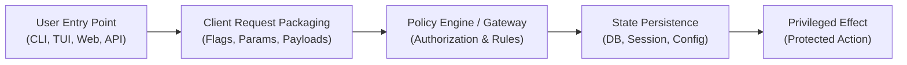

# Gated features and capabilities audit guide

Gated features—such as permission modes, security bypass flags, user consent dialogs, role-based access controls,
and tiered feature flags—represent high-risk audit targets. They sit at the intersection of user interface ergonomics,
state persistence, and security policy.

A common flaw in gated features is asymmetry: automated tests thoroughly verify that unauthorized requests are denied,
but fail to verify that eligible users can successfully discover, request, and use the feature through standard
user-facing mechanisms.

---

## 1. Trace the capability lifecycle across boundaries

Map how the capability flows from the human interface to execution:

Trace each stage:
1. **Entry interfaces**: Does the capability have reachability through all advertised paths (CLI flags, interactive
   prompts, config files, environment variables, keyboard shortcuts, or UI controls)?
2. **Packaging and serialization**: Does the client serialize the user's intent without dropping flags or fields?
3. **Policy authority**: Is authorization decided by a single authoritative component (e.g. backend service or daemon),
   rather than scattered across ad-hoc client-side checks?
4. **Durable persistence**: Where is the grant or consent stored? Is it durable across restarts, scoped to the current
   session, or tied to a specific project/workspace?
5. **Privileged effect**: Does the protected operation actually execute when granted, and is it genuinely blocked
   when not granted?

---

## 2. Standard test scenario matrix for gated features

Evaluate every gated capability against these nine essential scenarios:

| # | Scenario Promise | Test Procedure and Observation |
|---| --- | --- |
| 1 | **Every advertised choice is selectable** | Open the interactive selector, menu, or command list. Select each available option. Confirm the system acknowledges each choice and updates state. Test cancellation to ensure state remains untouched. |
| 2 | **Keyboard / shortcut navigation visits all choices** | If a shortcut or tab key cycles through choices or modes, trace the entire cycle under both permitted and restricted policies. Do not assume cycling order matches internal enum ordering. |
| 3 | **Explicit flags and CLI arguments reach the engine** | Start the workflow with explicit command-line flags or configuration options. Verify the authority engine receives the arguments, applies precedence rules, and commits the state. |
| 4 | **Conflicting or invalid options fail actionably** | Supply mutually exclusive flags, invalid parameter combinations, or malformed inputs. Verify the system aborts cleanly with a descriptive, user-friendly error rather than undefined behavior or silent fallbacks. |
| 5 | **Justified refusal under missing prerequisites** | Run the identical request under missing preconditions (untrusted directory, missing credentials, unprivileged role, or disabled global policy). Verify the system refuses with actionable guidance, leaving data unchanged. |
| 6 | **Persistence and session resumption** | Grant permission, restart the application or service daemon, and resume the session. Verify that granted authority persists if designed to be durable, or safely prompts again if ephemeral. |
| 7 | **Immediate enforcement upon revocation** | Revoke consent or demote privileges in settings/database. Attempt the privileged action immediately. Confirm the system blocks access without relying on stale in-memory cached grants. |
| 8 | **Scope containment and isolation** | Grant permission for Workspace A or Session A. Open a fresh Workspace B or Session B. Verify that the privileged grant does **not** leak across workspaces, users, or sessions. |
| 9 | **Three-layer consistency** | Verify the UI presentation (badge, banner, prompt), authoritative state (database record, config entry), and external side effect (file written, API call executed) all agree. |

---

## 3. High-priority mutation candidates

When validating test sensitivity for gated capabilities (see [mutations](mutations.md)), prioritize these realistic
defect injections:

1. **Drop authorization flag in client serializer**: Mutate the client to omit the authorization field when sending the
   request payload to the server.
   - *Expected test result*: The test must detect that the server did not receive the grant and refused privileged action.
2. **Omit option from interactive picker or shortcut cycle**: Remove one option from the UI picker list or cycling logic.
   - *Expected test result*: The test must fail when attempting to navigate to or select that specific option.
3. **Ignore flag on session resume**: Mutate the session resumption code to initialize with default permissions rather
   than honoring the previously saved mode.
   - *Expected test result*: The resumption test must fail.
4. **Premature UI display**: Render the "Access Granted" banner before the backend authority acknowledges the request.
   - *Expected test result*: The test must fail if the backend returns an error or delay.
5. **Invert policy guard**: Alter the authorization check to always return true (allow all) or always return false
   (deny all).
   - *Expected test result*: An always-allow mutant must be caught by refusal tests; an always-deny mutant must be caught
     by positive access tests.

---

## 4. Common antipatterns to eliminate

- **Refusal-Only Testing**: A test suite has 10 tests confirming unauthorized users get HTTP 403 or CLI error, but zero
  tests confirming an authorized user can complete the end-to-end task.
- **Shared-Enum Assertion**: A test checks `picker.getOptions().length == MyEnum.values().length`. If an option is
  accidentally deleted from `MyEnum`, both the test and production code shrink together, and the test stays green.
  Assert against explicit, expected strings derived from user documentation.
- **Banner-Only Verification**: A test asserts `assert(screen.contains("Mode: Bypass"))` but never attempts to perform
  the privileged operation that bypass is supposed to allow.
- **Backdoor Seeding**: A test sets up a user by directly inserting a row into SQLite or Redis with `is_admin = true`,
  completely bypassing the onboarding or grant flow that a real user must navigate.
